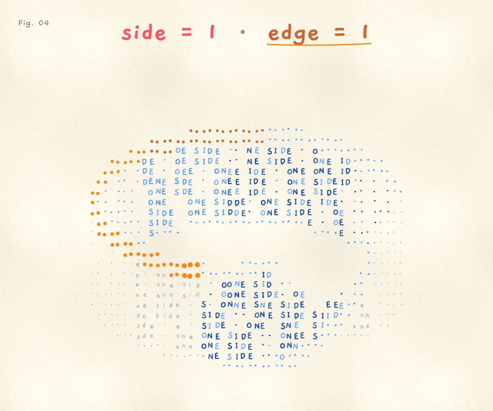

# The Möbius strip, in letters

Fig. 04 in my "math facts that live in my head" series.

A Möbius strip written in its own words: ONE SIDE in capitals on one face, one side in small letters on the other, running straight into each other through the twist. An orange streak runs along the edge. After one lap the top edge has turned into the bottom edge, and after two it is back where it started. The strip has one side and one edge.

Open it: https://ibeez.github.io/mobius-strip/

Drag to turn it. Tap either fact to start the edge over. Works on a phone too. The colours are sampled from real markers.

[Watch one loop (MP4)](exports/mobius-edge-loop.mp4)



## Run it locally

```bash
python3 -m http.server 8768 --bind 127.0.0.1
```

Then open http://127.0.0.1:8768/. Running locally also shows a **Record one loop** button.

## How it works

One canvas, plain JavaScript, no libraries. The strip is sampled point by point, projected, and z-buffered into a grid of letters. Cells where the strip turns edge-on become dots so letters never pile up. The edge is tracked as one coordinate that runs twice around the ring, so the highlight never jumps.
